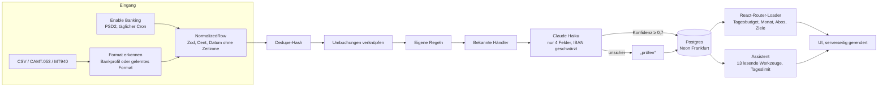

# Haushaltsbuch

Ein Haushaltsbuch, das zuerst die Frage beantwortet, die man wirklich hat: **Wie viel kann ich heute ausgeben?** Kontoauszüge kommen per Bankanbindung oder Datei, Regeln und ein LLM kategorisieren, ein KI-Assistent rechnet mit echten Zahlen. Was die KI nicht sicher weiß, wird nicht geraten, sondern landet in „prüfen“.

| | |
|---|---|
| **Demo** | [haushaltsbuch-demo.vercel.app](https://haushaltsbuch-demo.vercel.app): erfundene Daten, ohne Login, nur lesend. Der Assistent antwortet dort mit dem echten Claude-Modell (begrenzte Zahl Fragen pro Tag). |
| **App** | [haushaltsbuch-woad-tau.vercel.app](https://haushaltsbuch-woad-tau.vercel.app): Produktion mit Login, echtem Claude-Modell und Bankanbindung |
| **Code** | [github.com/benschuetze/haushaltsbuch](https://github.com/benschuetze/haushaltsbuch) |

## Was die App kann

**Frag zuerst**
- **Tagesbudget:** Die Startseite zeigt eine Zahl: was bis zum nächsten Gehalt pro Tag bleibt. Die App erkennt Gehalt und Zahltag selbst, zieht kommende Fixkosten, Sparraten und offene Sparziel-Anteile ab und rundet ab. Unter „Wie gerechnet?“ steht die Rechnung Zeile für Zeile.
- **Assistent:** Fragen tippen oder sprechen („Kann ich mir ein Fahrrad für 600 € leisten?“, „Wann kann ich mir das leisten?“, „Habe ich versteckte Abo-Kosten?“). Claude Haiku antwortet über 13 lesende Werkzeuge (`heute_verfuegbar`, `leisten`, `wann_leisten`, `naechste_zahlungen`, `buchungen_suchen`, `abos_und_fixkosten` …) mit echten Zahlen aus der Datenbank. Er kann nichts ändern; höchstens 60 Fragen am Tag.

**Weniger Arbeit**
- **Import ohne Einstellungen:** CSV, CAMT.053 oder MT940 hochladen, auch mehrere Dateien. Die App erkennt Bank und Konto (über die eigene IBAN). Unbekannte CSV-Formate lernt sie beim ersten Upload, erst kostenlos über Spaltennamen, dann per LLM, das nur Spaltennamen und maskierte Muster sieht.
- **Bankanbindung:** Enable Banking (PSD2, 2.500+ Banken), Lesezugriff bis 180 Tage, täglicher Abruf per Cron. Andere Institute sind als Kacheln mit echten Logos vorhanden und sichtbar als **Mockdaten** gekennzeichnet.
- **Prüfen per Wischen:** Unsichere Buchungen kommen als Karten. Rechts wischen übernimmt den Vorschlag, links schiebt auf.
- **Regel-Agent:** „Alles von Rewe ist Lebensmittel“ in normaler Sprache. Der Agent baut die Regel, zeigt vorher, welche Buchungen sie trifft, und legt sie erst nach Bestätigung an.

**Überblick und Motivation**
- **Sparziele** mit Rate pro Monat, die das Tagesbudget schon einplant, und Konfetti beim Erreichen. Ein laufender Sparauftrag (gleicher Betrag ans Tagesgeld, Monat für Monat) wird erkannt und lässt sich mit einem Klick zum Ziel machen; seine Überweisungen zählen dann automatisch als Einzahlung.
- **Wochenrückblick** mit Vergleich zu denselben Wochentagen und Serien; **Monatsrückblick** als Karten zum Durchwischen.
- **Abos und Fixkosten** werden erkannt. „Kündigen“ öffnet die Kündigungsseite des Anbieters. Die Glocke meldet Preiserhöhungen und ablaufende Bankzugänge.
- **Budgets** je Kategorie, Monatsübersicht mit Vormonatsvergleich. Umbuchungen zwischen eigenen Konten, PayPal-Aufladungen und Kreditkartenausgleich zählen nicht doppelt.

**Design:** „E-Ink-Kassenbuch“, Papier und Tinte wie ein E-Paper-Display, eine Akzentfarbe (Kugelschreiber-Blau) für die eine wichtige Zahl, doppelt unterstrichen wie eine Summe in der Buchhaltung. Am Handy eine Tab-Leiste mit der Frage in der Mitte.

## Architektur



Alles läuft in einer React-Router-App auf Vercel: Loader und Actions sind der Server, `app/lib` enthält die Logik ohne UI. Datenzugriff gibt es nur dort, nie in Komponenten.

## Entscheidungen

| Entscheidung | Warum |
|---|---|
| Geld als Integer in Cent, Parsing nur in `money.ts` | Floats runden falsch (0,1 + 0,2). Jeder Betrag kommt als Text aus der Bank und wird ohne `parseFloat` gelesen. |
| Das Günstigste zuerst: Regeln, Händlerliste, dann LLM | Jeder Modellaufruf kostet Geld und ist nicht deterministisch. Was eine Regel weiß, fragt man kein Modell. |
| Unsicher heißt „prüfen“, nie geraten | Eine falsche Kategorie mit hoher Konfidenz sieht niemand. Eine Frage kostet den Nutzer zwei Sekunden. |
| `manual` schlägt alles, in der SQL-Bedingung | Eine Korrektur des Nutzers darf kein späterer Import und keine neue Regel überschreiben, auch nicht durch einen Bug im App-Code. |
| Tagesbudget statt Kontostand | CSV-Exporte enthalten selten einen Saldo. Die App rechnet pro Gehaltsperiode: was kam, was ging, was noch fällig ist. |
| Assistent nur mit lesenden Werkzeugen | Ein Sprachmodell soll rechnen lassen, nicht selbst rechnen, und nichts ändern können. Jede Zahl in der Antwort kommt aus einem Werkzeug. |
| Tageslimits atomar in der Datenbank | Ein `UPDATE … FOR UPDATE` statt Zählen im Speicher: Serverless-Instanzen teilen keinen Speicher, zwei gleichzeitige Anfragen können das Limit nicht überholen. |
| Unbekannte CSV-Formate lernen statt nur feste Profile | Es gibt Hunderte Banken. Die Zuordnung der Spalten sieht das Modell nur als Spaltennamen und maskierte Muster und wird pro Format gespeichert. |
| Import ohne Datenbank-Transaktion, dafür wiederholbar | Der Treiber `neon-http` kennt keine interaktiven Transaktionen. Statt eines zweiten Treibers (WebSocket-Pool) nur für Schreibvorgänge ist jeder Schritt wiederholbar: Buchungen sind per Dedupe-Hash idempotent, der Import trägt einen Status (`running`/`done`/`failed`), und der nächste Import holt Buchungen abgebrochener Importe nach. Ein Test bricht nach dem ersten Block ab und prüft, dass danach nichts ohne Kategorie oder „prüfen“ bleibt und nichts doppelt ist. |
| Erwartungswerte von Hand nachgerechnet | Ein Test, der seine Erwartung aus dem App-Code holt, prüft nichts. [`beispieldaten/erwartet.json`](beispieldaten/erwartet.json) ist unabhängig. |

## Typsicherheit

- **Eine Quelle:** Tabellen und Typen kommen aus [`schema.ts`](app/lib/db/schema.ts) (`$inferSelect`, `$inferInsert`), es gibt keine doppelten Interfaces.
- **Grenzen geprüft:** Formulare, CSV-Zeilen, Bank-API-Antworten und jede einzelne LLM-Antwort laufen durch Zod. Was nicht passt, wird mit Grund abgelehnt oder landet in „prüfen“.
- **Ende zu Ende:** React Router erzeugt Typen pro Route (`+types/…`), Loader-Daten sind in der Komponente typisiert. `tsc --noEmit` im strikten Modus ist Teil von `pnpm check` und der CI.

## Kategorisierung einer Buchung

```
Datei/Bank ──► Bankprofil ──► Dedupe ──► Umbuchungen ──► Regeln ──► LLM ──► Konfidenz ≥ 0,7 ? ──► fertig
               (Zod)         (Hash)     verknüpfen     (Priorität) (nur 4 Felder)      │
                                                                                       └──► „prüfen“
Korrektur in der UI ──► manuell (nie wieder überschrieben) ──► optional Regel ──► alle passenden Buchungen neu
```

- **Keine Zeile geht still verloren:** Jede Zeile ist danach neu, Duplikat, übersprungen (z. B. vorgemerkt) oder mit Zeilennummer und Grund abgelehnt. Beträge werden ohne Float gelesen, alles ist in Cent.
- **Duplikate:** Hash aus Konto, Datum, Betrag, Empfänger und Zweck; zwei echte gleiche Zahlungen am selben Tag bleiben beide erhalten.
- **LLM:** Batches à 25, strukturierter Output über das Vercel AI SDK. Jede Antwort wird einzeln mit Zod geprüft: unbekannte Kategorie, fehlende Antwort, kaputtes JSON oder Netzwerkfehler schicken genau diese Buchung nach „prüfen“, der Import läuft weiter.
- **Manuell schlägt alles:** Das sichert die `WHERE`-Klausel des Updates in der Datenbank ab, nicht nur der App-Code.

## Datenschutz und Sicherheit

- An das LLM gehen nur Empfänger, Verwendungszweck, Betrag und Datum, IBANs darin geschwärzt. Keine Kontonummer, keine Rohdaten.
- Bank-Sitzungen sind mit AES-256-GCM verschlüsselt gespeichert.
- Strikte Content Security Policy mit Nonce, CSRF-Prüfung, Login-Drosselung, HSTS, `Permissions-Policy` (Mikrofon nur für die Spracheingabe), `noindex`.
- XML-Kontoauszüge mit DOCTYPE oder ENTITY werden abgelehnt (XXE, „Billion Laughs“).
- Die Demo ist schreibgeschützt; Schreibzugriffe blockiert eine Middleware für jede Route.
- Jeder Produktions-Build schickt eine Mini-Anfrage an die echte Claude-API und an die Bank-API und bricht ab, wenn Key, Modell oder Schlüssel nicht stimmen.

## Datenmodell

`accounts` · `imports` · `categories` · `transactions` · `rules`, Details in [`PLAN.md`](PLAN.md) und [`app/lib/db/schema.ts`](app/lib/db/schema.ts). Das Drizzle-Schema ist die einzige Quelle für Typen, Zod prüft alle Eingänge (Formulare, CSV-Zeilen, LLM-Antworten).

## Stack

React Router 7 (Framework-Modus) · TypeScript strict · Drizzle ORM · Neon Postgres · Vercel · Vercel AI SDK mit Claude · Tailwind · shadcn/ui · Vitest · PGlite · Playwright · axe-core · Biome · GitHub Actions

## Lokal starten

Voraussetzung: Node 22+ und pnpm (`corepack enable`). Ein lokales Postgres ist nicht nötig, PGlite übernimmt.

```bash
pnpm install
cp .env.example .env   # APP_PASSWORD und SESSION_SECRET setzen, AI_MOCK=1 ohne API-Key
pnpm db:local          # Datenbank in .pglite/, migriert und mit Standardkategorien
pnpm dev               # http://localhost:5173
```

## Tests

| Befehl | Was |
|---|---|
| `pnpm test` | Unit- und Datenbanktests mit PGlite im Speicher, ohne Netz und ohne LLM |
| `pnpm test:e2e` | Playwright auf Desktop (Chromium) und iPhone (WebKit), mit Barrierefreiheits-Check (axe) |
| `pnpm eval` | 203 erfundene, von Hand beschriftete Buchungen durch den echten Ablauf (Händlerliste, dann Modell): Trefferquote gesamt und nur Modell, Anteil „prüfen“, sichere Fehler. Die kostenlose Stufe prüft schon `pnpm test` |

Die Erwartungswerte für die Demo-Daten stehen in [`beispieldaten/erwartet.json`](beispieldaten/erwartet.json). Sie sind von Hand nachgerechnet und nicht mit dem App-Code erzeugt.

Die wichtigste Zahl im Eval ist „falsch mit Konfidenz ≥ 0,7“. Diese Fehler sieht der Nutzer nicht, weil sie nicht in „prüfen“ landen.

## Grenzen

- Ein Benutzer, Login per Passwort. Für mehrere Haushalte fehlen Mandanten und echte Konten.
- Eingebaute Bankprofile für Sparkasse (CSV-CAMT V2), ING, DKB, Volksbank/Raiffeisenbank, PayPal und American Express (dort sind Einkäufe im Export positiv, die App dreht das Vorzeichen), nachgebaut nach den Exportformaten. Außerdem die Bankformate CAMT.053 (XML, ISO 20022; Dateien mit DOCTYPE werden abgelehnt) und MT940. Pro Konto ein Exportformat verwenden: CSV und CAMT derselben Bank landen in getrennten Konten. Bei PayPal und Kreditkarte zählt der Einkauf als Ausgabe; Aufladung bzw. Kartenausgleich und die passende Abbuchung auf dem Girokonto (gleicher Betrag, höchstens 5 bzw. 10 Tage auseinander) werden als Umbuchung verbucht, damit nichts doppelt zählt. Andere Banken lernt die App beim ersten Upload; getestet mit nachgebauten Exporten von N26, Deutscher Bank (Soll/Haben), comdirect (Empfänger im Buchungstext) und einem Fantasieformat. Alle Beispieldaten sind erfunden: [`beispieldaten/banken/`](beispieldaten/banken).
- Live-Bankabruf nur über Enable Banking (im eingeschränkten Modus: die eigenen, im Portal verknüpften Konten). Alle anderen Kacheln unter „Banken“ sind ausdrücklich als **Mock** gekennzeichnet: Sie zeigen den Ablauf mit erfundenen Buchungen in einem Konto „… (Mock)“, das sich mit einem Klick wieder entfernen lässt. Echte Umsätze dieser Institute kommen per Datei-Import.
- Die Logos unter `public/logos/` sind die App-Icons der Institute von ihren offiziellen Websites (als PNG neu kodiert) und Marken der jeweiligen Inhaber. Sie dienen nur dazu, das Institut zu erkennen.
- Ob eine Abo-Kündigung geklappt hat, liest die App aus späteren Buchungen, nicht von der Seite des Anbieters: Die lässt sich weder einbetten noch auslesen.
- Das Modell sieht keine Historie: Eine Buchung, die es letzten Monat richtig hatte, kann es diesen Monat anders einordnen. Regeln machen das stabil.

## Arbeitsweise mit Claude Code

Das Projekt ist mit Claude Code als primärem Werkzeug entstanden. [`CLAUDE.md`](CLAUDE.md) legt Stack, Regeln und Befehle fest, [`.claude/skills/`](.claude/skills) enthält die wiederkehrenden Abläufe:

| Skill | Wofür |
|---|---|
| `verify` | Tests schreiben, ausführen und die UI im Browser prüfen, bei jeder Änderung |
| `db-change` | Schema ändern, Migration erzeugen und auf `DROP` prüfen |
| `bank-profile` | Neues CSV-Format einer Bank unterstützen |
| `categorizer-eval` | Prompt oder Modell ändern und vorher/nachher messen |
| `e-ink-design` | Neue UI im E-Ink-Look bauen |
| `ship` | Commit, CI, Preview und Produktion prüfen |

Grundsätze: Jeder Fehler bekommt zuerst einen Test, der ihn zeigt. Tests beschreiben das Versprechen an den Nutzer, nicht die Implementierung. Nichts gilt als fertig, was nicht gelaufen und gesehen wurde.
